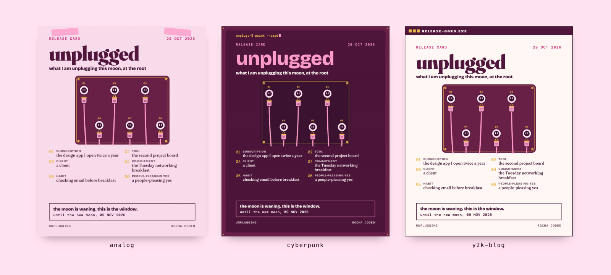
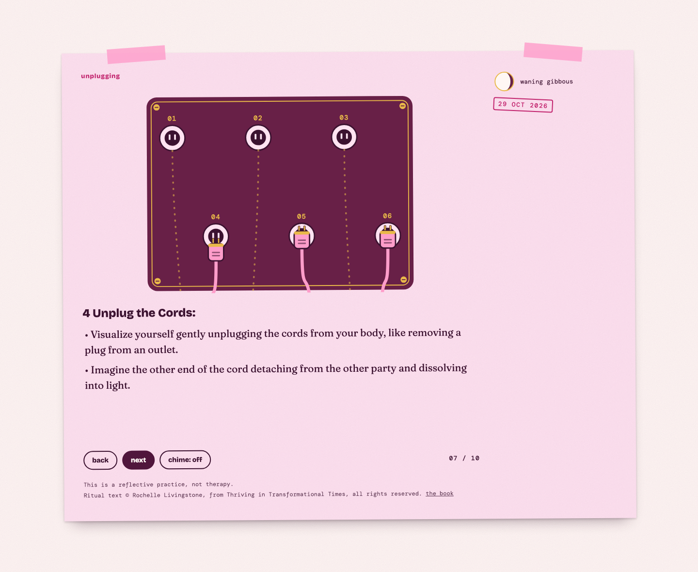
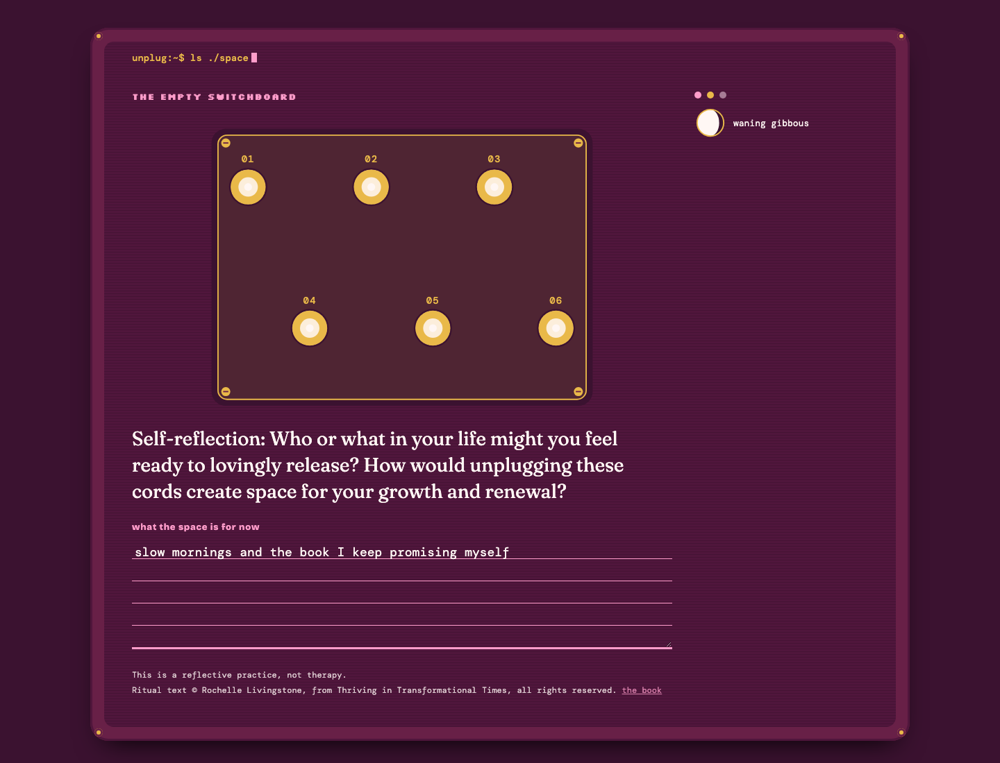

# Unplugging

*Rocha Coded. Free tools from the Rocheverse.*

**Unplug what drains you, at the root. Her ritual, then the actual list.**

Rocha's Cord Removal Ritual, from her book, one gentle step at a time.
She unplugs cords at the root, like a plug from a socket, so they stay unplugged.
Then the practical part: the subscriptions, tools, clients, commitments, habits and people-pleasing yeses you are ready to release this moon.
You get a release card to share, a private copy, and kind "no" email drafts in your own words.

<p align="center"></p>

<p align="center"></p>

<p align="center"><sub>One card, three moods: analog, cyberpunk, y2k-blog. This one is a made-up founder in Rocha's colours. Yours holds your list.</sub></p>

## Start here
You can do this. Each step tells you what to type and what you will see when it worked.

**If you use Claude Code** (Claude in the terminal, the window where you type commands to your computer):

 Open the Terminal app. On a Mac it is in Applications > Utilities > Terminal.
   This checks that Python, the language the tool is written in, is ready:
   ```sh
   python3 --version
   ```
   You will see `Python 3.10` or a higher number.

 This copies the tool onto your computer. "Clone" means download a copy from GitHub, the site where the code lives:
   ```sh
   git clone https://github.com/RochaStone/unplugging ~/.claude/skills/unplugging
   ```
   You will see `Cloning into...` and then the line where you type comes back.

 This makes a folder for your pages and opens Claude Code inside it:
   ```sh
   mkdir -p ~/my-unplugging && cd ~/my-unplugging && claude
   ```
   You will see Claude Code open and wait for you.

 Type this to Claude, in your own words if you like:
   ```
   I'm ready to unplug some things.
   ```
   Claude offers Rocha's ritual first, then asks about your list, one question at a time.

 When Claude says READY, your card is waiting:
   ```sh
   open out/release-card.png
   ```
   You will see your release card. Your drafts are in `out/no-emails.md`, and your private copy is in `out/private`.

**If you use Claude Cowork** (the Claude desktop app): download the zip (one file that holds the whole tool),
upload it in Customize > Skills, give a task your unplugging folder, and say "I'm ready to unplug some things."
The full steps are under [Claude Cowork](#claude-cowork).

<p align="center"></p>

## What you get
- **The ritual, as she wrote it.** `ritual.html` walks you through Rocha's Cord Removal Ritual one step per screen, in her words only.
  A slow breath circle sits between steps. A soft chime is there if you want it, and it starts off.
  Each step unplugs one cord from the switchboard, and the last screen is an empty board filled with light.
  It is one file and works offline.
- **Your list.** The subscriptions, tools, clients, commitments, habits and people-pleasing yeses you are ready to release, asked one at a time.
- **A release card to share.** A 1080x1350 picture for your stories or your feed, with every person's name left off.
- **A private copy.** The same card with the names and your reasons, in `out/private`, for you alone.
- **Your "no" emails.** `no-emails.md` holds a checklist and a kind draft for each item that needs one, in your own words from the interview. Every one is a draft. Sending is yours.
- **The moon.** Your card shows the next waning moon. If the moon is waning today, it says this is the window. The moon is worked out on your computer from the astronomy itself.
- **The space.** `space.html` is the empty switchboard, Rocha's self-reflection question, and a blank for what the space is for now.

<p align="center"></p>

This is a reflective practice, not therapy.
Everything stays on your computer. The kit sends nothing anywhere and needs no account.

<p align="center"></p>

## Install
It runs inside Claude, or on its own in the terminal.

| Where you use it | Install it | Start it |
|---|---|---|
| [Claude Code](#claude-code) (recommended) | clone into `~/.claude/skills` | say "I'm ready to unplug some things" |
| [Claude Cowork](#claude-cowork) | upload `unplugging.zip` as a skill | ask in a Cowork task |
| [By hand](#by-hand-with-no-claude-at-all) | download or clone | `python3 unplug.py` |

You need Python 3.10 or newer. Google Chrome makes the PNG cards; every HTML page works without it.

### Claude Code
```sh
git clone https://github.com/RochaStone/unplugging ~/.claude/skills/unplugging
```
Open Claude Code in the folder where you want your pages, and say: "I'm ready to unplug some things."
To update later: `git -C ~/.claude/skills/unplugging pull`.

### Claude Cowork
Cowork (the Claude desktop app) runs tasks in a sandbox on your computer that can only reach the folders you give it.
1. Download `unplugging.zip` from the [latest release](https://github.com/RochaStone/unplugging/releases/latest).
2. In the Claude desktop app: Customize > Skills, then + > Create skill > Upload a skill, and pick the zip.
3. In Settings > Capabilities, turn on code execution and file creation.
4. Make a folder for your pages, for example `my-unplugging` in your home folder. Start a Cowork task, give it access
   to that folder, and say: "I'm ready to unplug some things."

### By hand, with no Claude at all
From this folder, in the terminal:
```sh
python3 unplug.py
```
It asks the questions one at a time, saves `unplug.config.json`, and builds everything.
You will see `READY. Your pages are in out/`.
For the ritual page alone: `python3 unplug.py ritual`.

<p align="center"></p>

## Make it yours
Your look lives in one file, `style.json`: your colours, your fonts, your motif and one stamp word.
It ships with two examples: `examples/style.rocha-coded.json` (Rocha's plum and blush) and a blank `style.example.json` for yours, explained in `STYLE.md`. Or ask Claude to make one with you from a few references.
Pick your motif, `analog`, `cyberpunk` or `y2k-blog`, to change the structure. Your palette re-tones the switchboard and all three motifs, so every version is yours to curate.
The same file works across every Rocha Coded tool, so you make it once.

Your words live in `unplug.config.json`: your list, your "no" sentences, your own word for the top of the card (`lines.card_title`) and a line of yours under it (`lines.intention`).
Draw your own plug and socket, if you like, and put them in `objects/mine/`. The switchboard wears them.

<p align="center"></p>

## If it goes wrong (everyone's first time) 
This happens to everyone the first time. Here are the most common moments and the fix for each.
- **The terminal says `command not found` for `python3` or `git`.** Your Mac may offer to install its developer tools. Click Install, wait for it to finish, and run the step again. If nothing pops up, install Python from python.org.
- **The build says "A few things to fix in your config first".** It lists each one in plain words, like a kind that is spelled differently. Fix those, or ask Claude to, and build again.
- **The build says Chrome is missing.** Your HTML pages are ready and open in any browser. Install Google Chrome and build again for the PNG cards.
- **A name shows on my share card.** The kit leaves off every name it knows about: yours, each person's, and anyone in `people`. Add the missing name to `people` in `unplug.config.json`, or give that item a `share_as`, and build again.
- **The chime makes no sound.** Some browsers wait for a click before they play sound. Click **chime: off** once to turn it on, and it plays at the end of each breath.

<p align="center"></p>

## What's inside
| File | What it does |
|---|---|
| `SKILL.md` | the steps Claude follows: the ritual, your list, the build, the hand-over |
| `unplug.py` | asks the questions, checks your config, and writes every page |
| `ritual/RITUAL.md` | Rocha's ritual text, word for word, with its own licence line |
| `core/ritual.py` | reads the ritual and splits it into screens, leaving every word as she wrote it |
| `core/pages.py` | the ritual page and the space page |
| `core/card.py` | the release card, the private copy and the no-emails drafts |
| `core/board.py` | the switchboard: sockets, plugs, cords, and the empty board filled with light |
| `core/frame.py` | one page shell, three motifs |
| `core/moon.py` | the moon maths and the waning window, worked out on your computer |
| `core/style.py` | finds your style.json and keeps your words yours |
| `unplug.example.json`, `examples/unplug.sample.json` | a blank config, and a made-up founder's |
| `examples/style.rocha-coded.json`, `style.example.json`, `STYLE.md` | Rocha's example style, your blank one, and what each key does |
| `objects/mine/` | your own plug and socket drawings |
| `scripts/render.py` | headless Chrome for the PNG cards and the checks |
| `scripts/make-readme-images.py` | makes every image in this README from the tool itself, listed in `docs/IMAGES.md` |
| `tests/` | the tests, and `tests/TESTING.md` with exactly what was run |

Everything is plain Python from the standard library and plain HTML. You install no packages.
The pages load their fonts from Google Fonts and fall back to fonts already on the computer when offline.

For the curious, try another look or another day by hand:
```sh
python3 unplug.py build unplug.config.json --motif cyberpunk --today 2026-11-20
```

## Credits
- **The ritual** is Rocha's, from her book *Thriving in Transformational Times: A Friendly Guide to Uplift and Shift Through Apocalyptic Changes and the Beginning of a New Era*, chapter 13. [The book on Amazon](https://www.amazon.com/dp/B0DXNR3BNJ).
  Ritual text © Rochelle Livingstone, from Thriving in Transformational Times, all rights reserved.
  The MIT licence covers the code. The ritual text has its own terms in [LICENSE-RITUAL.md](LICENSE-RITUAL.md).
- **The moon** follows Jean Meeus, *Astronomical Algorithms* (2nd edition), chapter 49, ported from the sibling Rocha Coded kit analog-bag (MIT).
- **The style loader, the Chrome renderer and the pixel badges** come from the sibling kit desktop-altar (MIT), which took them from desktop-core.
- **Fonts** from Google Fonts under the SIL Open Font License: Fraunces, Bricolage Grotesque, DM Mono, Permanent Marker, Pinyon Script and Silkscreen.

## Licence
The code is MIT. See [LICENSE](LICENSE). Copyright (c) 2026 Rochelle Livingstone / Thriving Era Studio.
The ritual text is all rights reserved. See [LICENSE-RITUAL.md](LICENSE-RITUAL.md).

 [Sign my guestbook](https://github.com/RochaStone/unplugging/issues)

## Made by Rocha

Rocha \
Brand Alchemist & AI Architect \
Author of *Brand Alchemy in the Thriving Era* and *Thriving in Transformational Times* \
Creator of [Conscious Founder Operating System](https://founders.thrivingera.com) \
Founder, [Thriving Era Studio](https://thrivingera.com)

I help female founders build their founder world, and I build what they need next. \
Start with the audit: [thrivingera.com/audit](https://thrivingera.com/audit). \
Or book an exploratory call: [calendly.com/rochelle-thrivingera/exploratory-call](https://calendly.com/rochelle-thrivingera/exploratory-call). It is where we decide if we work together.

[Instagram @rocheverse](https://instagram.com/rocheverse) · [Substack](https://rochastone.substack.com) · [LinkedIn](https://www.linkedin.com/in/rochellelivingstonecosmic) · [More free tools](https://thrivingera.com/free) · [All tools on GitHub](https://github.com/RochaStone)
